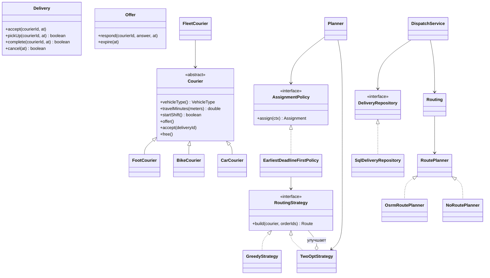

# delivery-java — сервис доставки на Java (ООП)

Объектно-ориентированная реализация сервиса `delivery` системы food-delivery
(этап 4 практики). Контракт тот же, что у TS-сервиса `apps/delivery` и
процедурной Python-версии `delivery-py`: те же HTTP-маршруты и коды ответов,
формат ошибок `{code, message, details, service, correlationId}`, база
`delivery_db` (PostGIS), события в топик `delivery.events` через Transactional
Outbox, позиция курьера в Redis (`courier:loc:{id}`, канал `ws:order:{orderId}`),
маршрутизатор OSRM за размыкателем цепи. Остальные сервисы замену не замечают.

Внутри — планировщик «последней мили»: граф улиц и Дейкстра, распределение
заказов по курьерам с окнами доставки, ближайший сосед и 2-opt.

## Сборка и проверка

Нужны JDK 21+ и Maven 3.9.

```bash
mvn -q test       # 30 тестов JUnit
mvn -q package    # target/delivery-java-all.jar — со всеми зависимостями
```

## Запуск сервиса

```bash
java -jar target/delivery-java-all.jar
```

Переменные окружения — те же, что у TS-версии:

| Переменная | По умолчанию | Смысл |
| --- | --- | --- |
| `DELIVERY_PORT` | 3004 | порт HTTP |
| `POSTGRES_HOST`, `POSTGRES_PORT`, `POSTGRES_USER`, `POSTGRES_PASSWORD`, `DELIVERY_DB` | localhost, 15432, app, app, delivery_db | база сервиса |
| `REDIS_HOST`, `REDIS_PORT` | localhost, 16379 | позиция курьера |
| `KAFKA_BROKERS`, `KAFKA_CLIENT_ID` | localhost:19092, delivery | брокер событий |
| `OUTBOX_POLL_INTERVAL_MS`, `OUTBOX_BATCH_SIZE` | 500, 100 | отправка из outbox |
| `KEYCLOAK_ISSUER`, `KEYCLOAK_INTERNAL_URL`, `AUTH_AUDIENCE` | …/realms/food-delivery, —, food-delivery-api | проверка токенов |
| `AUTH_DISABLED` | false | токен без проверки подписи — только тесты и стенд, в production запрещено |
| `DELIVERY_INTERNAL_TOKEN` | delivery-internal-dev-token | служебный токен для `order` |
| `DISPATCH_RADIUS_METERS`, `OFFER_TTL_SECONDS`, `COURIER_FRESH_SECONDS`, `OFFER_SWEEP_INTERVAL_MS` | 3000, 90, 120, 1000 | подбор курьера |
| `OSRM_URL`, `OSRM_TIMEOUT_MS` | http://localhost:15000, 500 | маршрутизатор; пустая строка — по прямой |
| `POSITION_TTL_SECONDS`, `LOCATION_FLUSH_INTERVAL_MS`, `LOCATION_MAX_BUFFER` | 60, 3000, 10000 | позиция и история координат |
| `NODE_ENV`, `LOG_LEVEL` | development, info | режим и уровень журнала |

Сквозная проверка на стенде практики (инфраструктура в Docker, остальные
сервисы — из исходного проекта):

```bash
../scripts/stand.sh up java
../scripts/stand.sh e2e
../scripts/stand.sh down
```

В Docker: `docker build -t food-delivery/delivery-java:local .`

## Планировщик «последней мили»

```bash
java -jar target/delivery-java-all.jar plan ../data/moscow_sample.json
java -jar target/delivery-java-all.jar plan ../data/moscow_sample.json --json
```

Формат задачи — тот же JSON, что у `delivery-py` (`python -m delivery.lastmile`).
Отчёт совпадает с Python-версией строка в строку, кроме строки со временем
расчёта: на `moscow_sample.json` — 18 из 20 заказов распределены, путь
67.05 км после 2-opt (жадный — 71.45 км), опозданий нет; Z19 — точка вручения
недостижима, Z20 — перегруз.

## Устройство

```
ru.mirea.delivery
├── domain       курьер, доставка, предложение — состояние и переходы внутри объектов
├── port         интерфейсы: хранилище, кэш позиций, история, маршрутизатор, брокер
├── app          сценарии: подбор, действия курьера, отслеживание
├── infra        реализации портов: PostgreSQL/PostGIS, Redis, Kafka, OSRM, фоновые задачи
├── http         маршрутизатор, контроллеры, проверка прав, формат ответов
├── lastmile     планировщик: граф, Дейкстра, стратегии маршрута, распределение
└── Main         сборка графа объектов и запуск
```



Отличие от процедурной версии: в Python курьер — словарь, а скорость берётся
из таблицы по типу транспорта; здесь вид транспорта — подкласс `Courier`, и
время в пути считает сам объект. Порты отделяют сценарии от базы, Redis и
брокера — сценарии и HTTP-слой проверяются тестами без инфраструктуры.
Стратегии маршрута взаимозаменяемы: 2-opt оборачивает любую другую стратегию.

На Windows с кириллицей в пути профиля сервер JDK не может создать
внутренний сокет; `Main` в этом случае сам задаёт каталог
`jdk.net.unixdomain.tmpdir` с путём латиницей.
