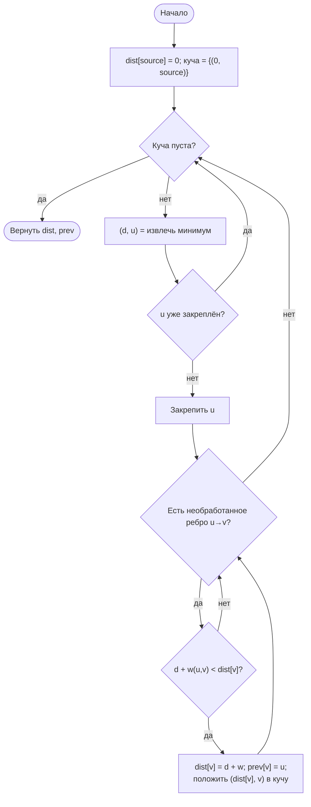
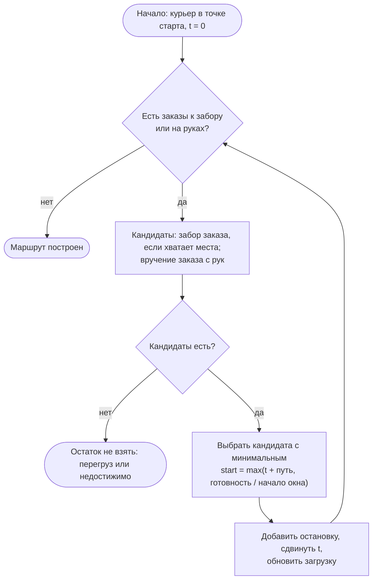
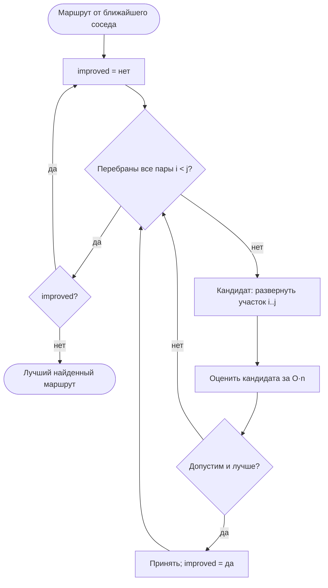
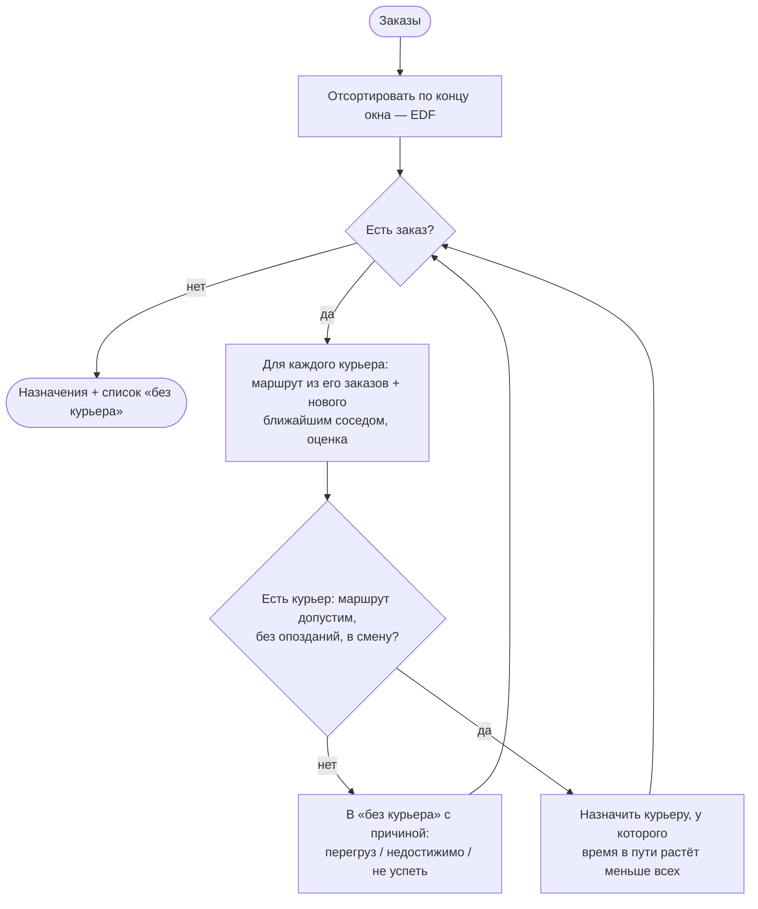

# Алгоритмы планирования «последней мили»

Материал к этапу 3 отчёта: постановка, алгоритмы, блок-схемы, оценка
вычислительной сложности и замеры на тестовом наборе. Реализация —
процедурная, `delivery-py/delivery/lastmile/` (функции над словарями,
без классов); ООП-реализация тех же алгоритмов — `delivery-java/`.

## Постановка

Дано:

- граф улиц `G = (V, E)` с длинами рёбер, часть улиц — с односторонним движением;
- курьеры: точка старта, транспорт (скорость, вместимость), длительность смены;
- заказы: ресторан (точка выдачи), адрес клиента (точка вручения), время
  готовности, окно доставки `[a, b]`, размер в условных местах.

Нужно назначить заказы курьерам и для каждого курьера построить порядок
остановок так, чтобы:

1. каждый заказ забирался и вручался ровно один раз, забор — раньше вручения;
2. на руках одновременно было не больше вместимости транспорта;
3. вручение начиналось не позже конца окна (раньше начала — курьер ждёт);
4. маршрут укладывался в смену;
5. суммарное время в пути было как можно меньше.

Это задача маршрутизации с вывозом и доставкой и временными окнами
(Pickup and Delivery Problem with Time Windows, PDPTW). Она обобщает
задачу коммивояжёра и задачу упаковки в контейнеры — обе NP-трудные.
Точный перебор назначений и порядков растёт как `k^m · (2m)!` (m заказов,
k курьеров) и уже на десятке заказов неприменим в реальном времени.
Поэтому решение строится эвристиками: быстрое жадное построение и
локальное улучшение.

## Конвейер


## 1. Кратчайшие пути — алгоритм Дейкстры

`graph.dijkstra(graph, source)`. Из двоичной кучи достаётся узел с
наименьшей оценкой расстояния, его соседи «релаксируются». Устаревшие
записи кучи пропускаются по множеству закреплённых узлов — так обходится
без операции «уменьшить ключ», которой у `heapq` нет.



Сложность `O((V + E) log V)`: каждое ребро релаксируется не более одного
раза, каждая операция с кучей — `O(log V)`. Матрица расстояний между P
точками задачи — P запусков: `O(P · (V + E) log V)`. Это дешевле алгоритма
Флойда — Уоршелла `O(V³)`, потому что точек задачи намного меньше, чем
узлов графа (на тестовом наборе P = 46, V = 145).

Недостижимый узел в словаре расстояний отсутствует — в матрице это `∞`,
и такие заказы на этапе распределения уходят в «без курьера» с причиной.

## 2. Маршрут курьера — «ближайший сосед»

`routes.nearest_neighbor_route`. Вариант Соломона для задач с окнами:
«ближайший» — не по расстоянию, а по времени, когда начнётся обслуживание
(дорога + ожидание готовности еды или начала окна клиента). При равенстве —
у кого раньше конец окна.



Сложность `O(n²)`: n = 2m шагов, на каждом перебор до n кандидатов.

## 3. Улучшение — 2-opt

`routes.two_opt`. Разворот участка маршрута между позициями i и j.
Перестановка принимается, если маршрут остаётся допустимым и становится
лучше: сначала меньше опоздание, затем короче путь. Проходы повторяются,
пока есть улучшение.



Сложность прохода — `O(n³)`: `O(n²)` пар, каждая оценивается за `O(n)`.
В классической задаче коммивояжёра выигрыш разворота считается за `O(1)`
(меняются два ребра) и проход стоит `O(n²)`. Здесь так нельзя: разворот
сдвигает время прибытия во всех следующих точках, а окна и порядок
«забрал → вручил» надо перепроверить по всему хвосту. Развороты, после
которых вручение оказывается раньше забора, отбрасываются оценкой.

## 4. Распределение заказов — жадно по сроку

`assign.assign_orders`.



Обоснование эвристики:

- **срочные — первыми** (EDF): заказ с близким концом окна имеет меньше
  вариантов, его выгодно разместить, пока курьеры свободны;
- **минимальное приращение** времени в пути — жадная стратегия «первого
  подходящего с наименьшей добавкой», известная по задаче упаковки
  (best fit): она не гарантирует оптимума, но даёт допустимое решение
  за полиномиальное время;
- **жёсткие ограничения** (окно, вместимость, смена) проверяются полной
  оценкой маршрута, поэтому назначение никогда не делает план недопустимым.

Сложность `O(m log m + m · k · n²)`.

## Сводка сложности

| Шаг | Функция | Время | Память |
|---|---|---|---|
| Граф | `graph.build_graph` | `O(V + E)` | `O(V + E)` |
| Кратчайшие пути из точки | `graph.dijkstra` | `O((V + E) log V)` | `O(V)` |
| Матрица между точками | `graph.distance_matrix` | `O(P (V + E) log V)` | `O(P²)` |
| Привязка точки к улице | `graph.nearest_node` | `O(V)` | `O(1)` |
| Оценка маршрута | `routes.evaluate_route` | `O(n)` | `O(n)` |
| Ближайший сосед | `routes.nearest_neighbor_route` | `O(n²)` | `O(n)` |
| 2-opt, один проход | `routes.two_opt` | `O(n³)` | `O(n)` |
| Распределение | `assign.assign_orders` | `O(m log m + m k n²)` | `O(m + k)` |

V — узлы графа, E — рёбра, P — точки задачи, m — заказы, k — курьеры,
n — остановки в маршруте курьера (n ≤ 2m).

## Замеры на тестовом наборе

`data/moscow_sample.json`: сетка 12×12 улиц центра Москвы с шагом ~300 м,
река с двумя мостами, 25 односторонних улиц, 6 курьеров, 20 заказов.

```
python -m delivery.lastmile ../data/moscow_sample.json
```

| Показатель | Значение |
|---|---|
| Граф | 145 узлов, 457 направленных рёбер |
| Распределено | 18 из 20, опозданий нет |
| Без курьера | Z19 — точка вручения недостижима; Z20 — перегруз (8 мест) |
| Путь после ближайшего соседа | 71,45 км |
| Путь после 2-opt | 67,05 км (−6,2 %) |
| Время расчёта (медиана 30 запусков, Python 3.12) | подготовка 14 мс, распределение 3 мс, 2-opt 4 мс |

## Где алгоритмы работают в самом сервисе

Сервис доставки (как и TS-оригинал) назначает заказы по одному, в момент
готовности: это частный случай задачи выше (m = 1). Он использует:

- **пространственный индекс GiST** — «ближайшие свободные курьеры в радиусе
  3 км»: `ST_DWithin` + сортировка `<->` (KNN), `O(log N + k)` вместо полного
  перебора N курьеров;
- **ранжирование по дорогам** — матрица OSRM «курьеры → ресторан» и время в
  пути по типу транспорта, `O(k log k)` на сортировку k ≤ 10 кандидатов;
- **цепочку предложений** — отказ или молчание 90 с передаёт заказ следующему
  кандидату; таймер хранится в базе и переживает перезапуск.

Пакетное планирование (`lastmile`) — следующий шаг: курьер берёт несколько
заказов по пути, и маршрут строится заранее с учётом окон.
