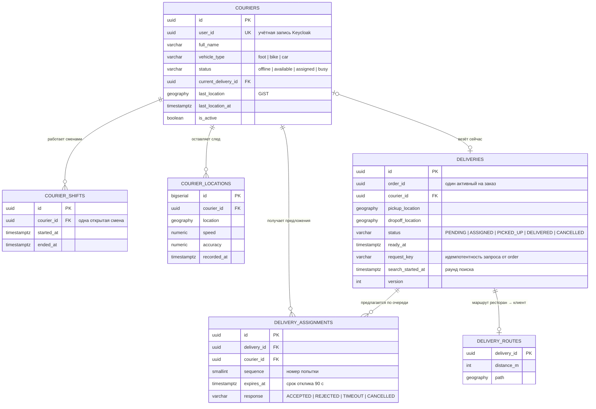
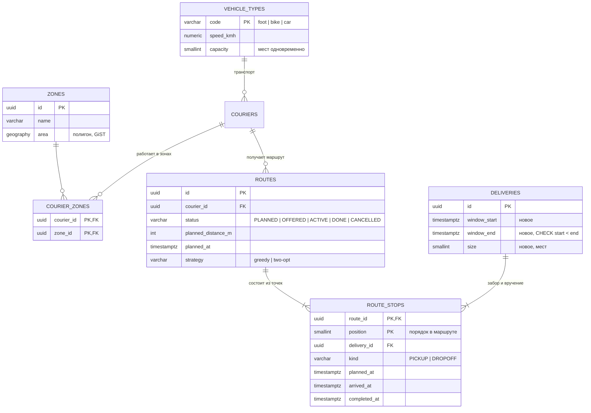

# Модель данных доставки

## Логическая модель «как есть» — `delivery_db`

Схема сервиса доставки исходного проекта (миграции
`food-delivery/infra/migrations/delivery/001–006`). Python- и Java-версии
сервиса работают с ней без изменений.

Плюс общие для всех сервисов `outbox_messages` (события в той же
транзакции, что и изменение данных) и `inbox_messages` (защита от повторов).

## Логическая модель «как будет» — расширение под «последнюю милю»

Чего не хватает для пакетной доставки с окнами (выделено в диаграмме
новыми сущностями и полями):

- **окно доставки** у заказа — `window_start`, `window_end`;
- **вместимость** — справочник транспорта вместо констант в коде;
- **зоны** — где курьер работает (пеший — в пределах района);
- **маршрут как последовательность точек** — несколько заказов у одного
  курьера, плановое и фактическое время на каждой точке.

Ограничения целостности, которые нужны в физической модели (этап 5):

- `UNIQUE (route_id, delivery_id, kind)` — заказ забирается и вручается в
  маршруте по одному разу;
- забор раньше вручения — проверяется триггером или в сервисе
  (`position` забора < `position` вручения);
- `CHECK (window_start < window_end)`, `CHECK (size > 0)`;
- частичный индекс активных маршрутов курьера:
  `CREATE UNIQUE INDEX … ON routes (courier_id) WHERE status = 'ACTIVE'`.

Физическая модель — `db/migrations/007_last_mile.sql` (все перечисленные
ограничения; забор раньше вручения — триггером-ограничением), проверка —
`db/check_migration.py`, сценарии — `docs/testing.md`.
