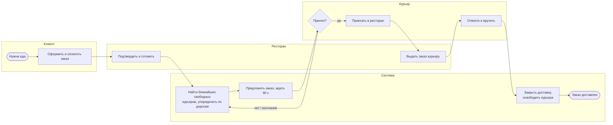
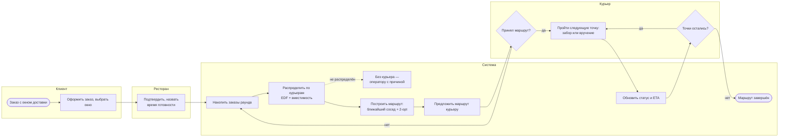

# Бизнес-процесс доставки «последней мили»

Модели в нотации BPMN 2.0 — файлы `diagrams/last-mile-as-is.bpmn` и
`diagrams/last-mile-to-be.bpmn` (открываются в https://demo.bpmn.io или
Camunda Modeler). Нотацию (BPMN или IDEF0) нужно подтвердить у
руководителя; ниже тот же процесс в виде схем Mermaid для отчёта.

## Как есть — один заказ на курьера

Так работает сервис доставки исходного проекта и его Python/Java-версии.

1. Клиент оформляет и оплачивает заказ (сервисы `order`, `payment`).
2. Ресторан подтверждает заказ и начинает готовить; оркестратор саги
   сразу просит курьера — курьер едет, пока еда готовится.
3. Сервис доставки находит ближайших свободных курьеров в радиусе 3 км
   (пространственный индекс) и упорядочивает их по времени в пути по
   дорогам с учётом транспорта.
4. Предложение уходит первому кандидату; на ответ — 90 секунд. Отказ или
   молчание — предложение следующему. Кандидаты кончились — «курьер не
   найден», `order` повторит запрос позже и поднимет флаг оператору.
5. Курьер принял — едет в ресторан, забирает заказ (отметка «забрал»,
   прогноз доставки по маршруту), везёт клиенту; клиент видит его на карте.
6. Курьер вручает заказ (отметка «доставил») и снова свободен.
7. Отмена заказа на любом шаге до вручения освобождает курьера (компенсация саги).

Ограничения процесса «как есть»:

- курьер везёт **один** заказ за раз — при пиковой нагрузке курьеров не
  хватает, хотя два заказа из одного ресторана в соседние дома можно отвезти
  за один рейс;
- у заказа нет **окна доставки** — только «как можно скорее»;
- назначение **жадное по одному заказу**: решение принимается без учёта
  заказов, которые появятся через минуту.

## Как будет — пакетная доставка с окнами

1. Клиент выбирает окно доставки; ресторан называет время готовности.
2. Система накапливает заказы раунда (например, раз в минуту).
3. Распределяет их по курьерам: срочные — первыми, с учётом вместимости
   транспорта и смены (`lastmile.assign`).
4. Строит маршрут каждого курьера: ближайший сосед, затем 2-opt
   (`lastmile.routes`).
5. Предлагает курьеру маршрут целиком; отказ — заказы возвращаются в
   следующий раунд.
6. Курьер проходит точки маршрута (забор и вручение вперемешку), на каждой —
   отметка; система обновляет статус заказа и пересчитывает прогноз для
   следующих клиентов.
7. Заказы, которые не взять (перегруз, недостижимый адрес, окно не успеть),
   уходят оператору с причиной.

## Какие операции автоматизируются

| Операция | Как есть | Как будет | Где в коде |
|---|---|---|---|
| Поиск кандидатов рядом | индекс GiST, радиус 3 км | то же | `store.candidates`, `store.nearest_candidate` |
| Порядок кандидатов | время в пути по дорогам (OSRM) | матрица расстояний по графу | `routing.rank_candidates`, `lastmile.graph` |
| Распределение заказов | по одному, жадно | раундом, EDF + вместимость | `dispatch.offer_next`, `lastmile.assign` |
| Построение маршрута | один отрезок ресторан → клиент | несколько точек, ближайший сосед + 2-opt | `routing.delivery_route`, `lastmile.routes` |
| Пересчёт ETA | при отметке «забрал» | после каждой точки | `couriers.picked_up`, `lastmile.routes.evaluate_route` |
| Переназначение при отказе | таймер 90 с, следующий кандидат | маршрут возвращается в раунд | `dispatch.expire_offers` |
